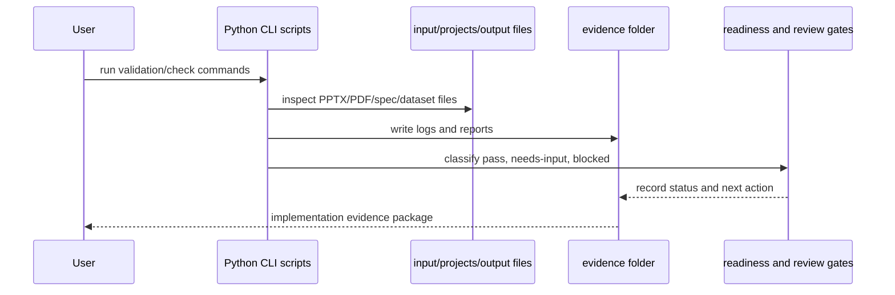

# CLI Evidence Sequence

## Commands Captured

- `validate_ai_training_workspace.py`
- `check_ai_training_readiness.py`
- `check_visual_ppt_conversion_inputs.py`
- `analyze_pptx_editability_inventory.py`
- `validate_revision_log.py`
- `check_final_fix_readiness.py`
