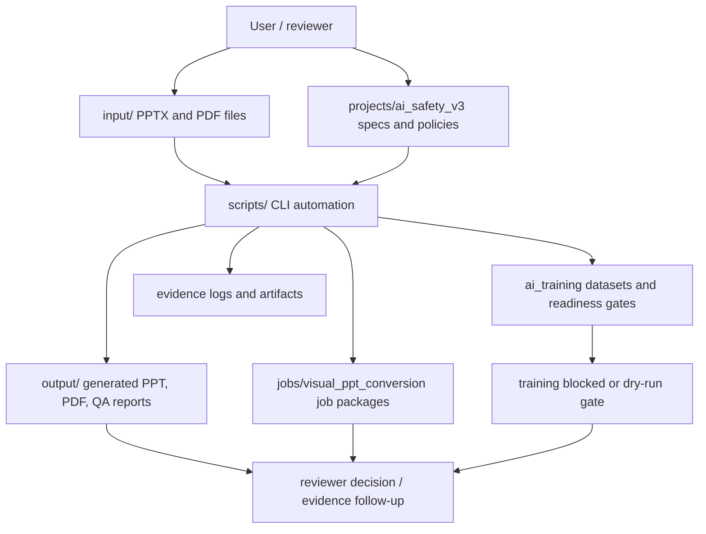

# Current Architecture

## Notes

- This is a local file-based automation workspace, not a deployed web service.
- No API server, frontend app, authentication layer, or production database was found.
- Model training is intentionally blocked by readiness gates.
